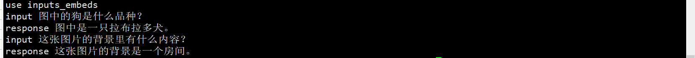

##  statement
- [deep_training](https://github.com/ssbuild/deep_training)

```text
    2024-06-12 init glm4v
```
   


## install
  - pip install -U -r requirements.txt
  - 如果无法安装 , 可以切换官方源 pip install -i https://pypi.org/simple -U -r requirements.txt  


## weight

- [glm-4v-9b](https://huggingface.co/THUDM/glm-4v-9b) 

    


## data sample
   open_data https://github.com/ssbuild/open_data
    

```json
{"id": 1, "conversations": [{"from": "system", "value": "You are ChatGLM4, a large language model trained by Zhipu.AI. Follow the user's instructions carefully. Respond using markdown."}, {"from": "user", "value": "图中的狗是什么品种？", "img": "../assets/demo.jpeg"}, {"from": "assistant", "value": "图中是一只拉布拉多犬。"}]}
{"id": 2, "conversations": [{"from": "user", "value": "这张图片的背景里有什么内容？", "img": "../assets/2p.png"}, {"from": "assistant", "value": "这张图片的背景是蒙蒙细雨。"}]}
{"id": 3, "conversations": [{"from": "user", "value": "这张图片的背景里有什么内容？", "img": "../assets/pig.png"}, {"from": "assistant", "value": "这张图片的背景是是虚化的。"}]}
```


## infer
    # infer.py 推理预训练模型
    # infer_finetuning.py 推理微调模型
    # infer_lora_finetuning.py 推理lora微调模型
     python infer.py





## training
```text
    # 制作数据
    cd scripts
    bash train_full.sh -m dataset 
    or
    bash train_lora.sh -m dataset 
    or
    bash train_ptv2.sh -m dataset 
    
    注: num_process_worker 为多进程制作数据 ， 如果数据量较大 ， 适当调大至cpu数量
    dataHelper.make_dataset_with_args(data_args.train_file,mixed_data=False, shuffle=True,mode='train',num_process_worker=0)
    
    # 全参数训练 
        bash train_full.sh -m train
        
    # lora adalora ia3 
        bash train_lora.sh -m train
        
    # ptv2
        bash train_ptv2.sh -m train
```

## 训练参数
[训练参数](args.MD)


## 友情链接

- [pytorch-task-example](https://github.com/ssbuild/pytorch-task-example)
- [chatmoss_finetuning](https://github.com/ssbuild/chatmoss_finetuning)
- [chatglm_finetuning](https://github.com/ssbuild/chatglm_finetuning)
- [chatglm2_finetuning](https://github.com/ssbuild/chatglm2_finetuning)
- [t5_finetuning](https://github.com/ssbuild/t5_finetuning)
- [llm_finetuning](https://github.com/ssbuild/llm_finetuning)
- [llm_rlhf](https://github.com/ssbuild/llm_rlhf)
- [chatglm_rlhf](https://github.com/ssbuild/chatglm_rlhf)
- [t5_rlhf](https://github.com/ssbuild/t5_rlhf)
- [rwkv_finetuning](https://github.com/ssbuild/rwkv_finetuning)
- [baichuan_finetuning](https://github.com/ssbuild/baichuan_finetuning)
- [baichuan2_finetuning](https://github.com/ssbuild/baichuan_finetuning)
- [xverse_finetuning](https://github.com/ssbuild/xverse_finetuning)
- [aigc_serving](https://github.com/ssbuild/aigc_serving)
- [aigc_evals](https://github.com/ssbuild/aigc_evals)

## 
    纯粹而干净的代码


## Reference
    https://github.com/THUDM/glm4v-6B


## Star History

[](https://star-history.com/#ssbuild/chatglm_finetuning&Date)

